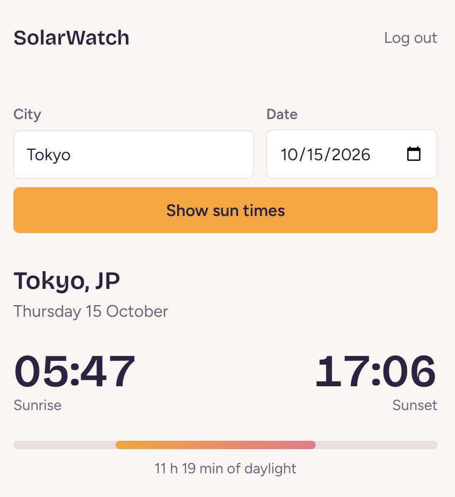
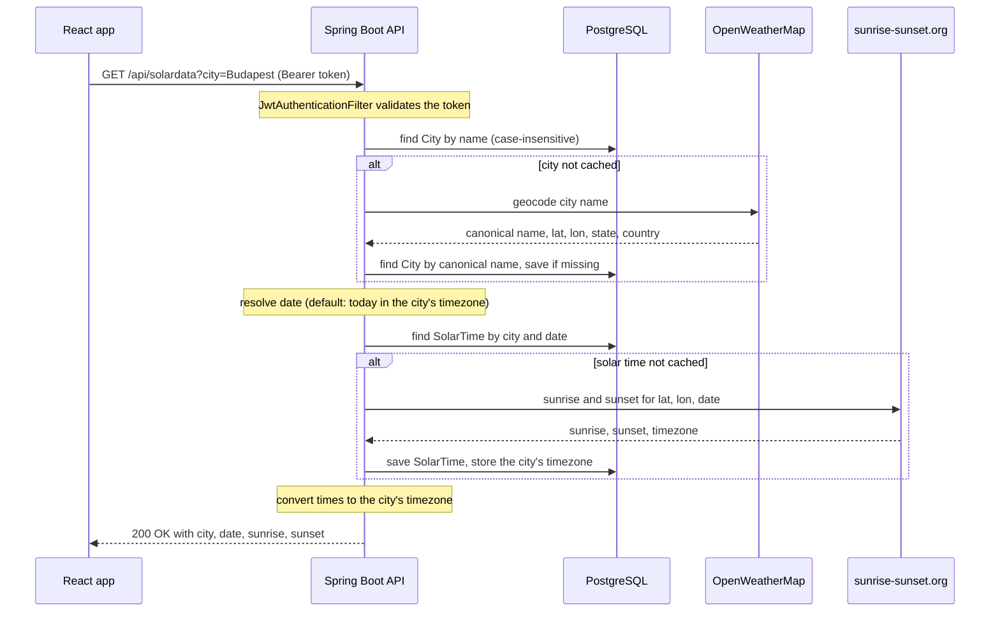

# SolarWatch

[](https://github.com/bucystoni/solar-watch/actions/workflows/maven.yml)


A full-stack web app that tells you when the sun rises and sets in any city. Type a city name, and a Spring Boot REST API resolves it to coordinates, fetches sunrise and sunset times from public APIs, and caches both in PostgreSQL, so repeat lookups never leave the database. Times are shown on the city's own clock, not the viewer's. Access is protected by stateless JWT authentication with user and admin roles.



## Features

- Register, log in, and stay logged in across page reloads
- Look up sunrise and sunset for any city, for today or a date picked in the search form
- Times are shown in the city's local timezone
- A day bar shows how much of the 24 hours is daylight, along with the day length
- City lookup is case-insensitive, and alternate spellings (e.g. `Budapeszt`) resolve to the same cached city
- Cities and solar times are cached in PostgreSQL after the first lookup
- Role-based access: every logged-in user can read, only admins can create, update or delete cities
- An admin account is seeded automatically on first startup

## Technical highlights

- **Read-through cache in the database.** `SolarWatchService` checks PostgreSQL first and only calls the external APIs on a miss, then stores the result. A unique constraint on `(city_id, date)` keeps one `SolarTime` row per city per day.
- **Timezone-correct times.** The app stores the instant, and the city's IANA timezone (e.g. `Asia/Tokyo`) separately, and converts at the edge: in the response DTO on the backend, and with the browser's built-in date formatting on the frontend. The day bar is positioned from the same formatted times, so the text and the bar always agree.
- **Testable time.** The default date comes from an injected `java.time.Clock`, so tests can freeze time and verify city-local "today" across a date boundary.
- **DTOs at the API boundary.** JPA entities never leave the service layer; endpoints return records such as `SolarTimeDto`, so storage changes don't leak into the API contract.
- **Stateless JWT authentication.** A custom `OncePerRequestFilter` validates the `Bearer` token on every request. Server-side sessions are disabled, passwords are hashed with BCrypt, and tokens are HMAC-SHA signed with a one-hour expiry.
- **Role-based authorization.** `USER` and `ADMIN` roles, enforced at method level with `@PreAuthorize` on the city write endpoints.
- **Deterministic integration tests.** `@SpringBootTest` with MockMvc against an in-memory H2 database, with the external API clients replaced by `@MockitoBean` and the clock by `@TestBean`, so the suite needs no network, Docker or API key.
- **Centralized error handling.** A `@ControllerAdvice` maps domain exceptions to HTTP status codes (`404` for an unknown city, `409` for a taken username).
- **Containerized and CI-checked.** Docker Compose runs PostgreSQL and the API, and the API waits until a healthcheck reports the database as ready. GitHub Actions runs the backend tests and the frontend lint and build on every push and pull request to `main`. Secrets come from environment variables and never enter Git.

## Tech stack

| Layer | Technologies |
|---|---|
| Backend | Java 21, Spring Boot 4.1 (Web MVC, Data JPA, Security), JJWT 0.13, Spring WebClient |
| Database | PostgreSQL 16 (H2 in-memory for tests) |
| Frontend | React 19, React Router 7, Vite 8, JavaScript |
| Testing | JUnit Jupiter, Spring Boot Test, MockMvc, Mockito |
| DevOps | Docker, Docker Compose, GitHub Actions, Maven Wrapper |
| External APIs | [OpenWeatherMap Geocoding API](https://openweathermap.org/api/geocoding-api), [sunrise-sunset.org](https://sunrise-sunset.org/api) |

## How it works



## Project structure

```
solar-watch/
├── .github/workflows/maven.yml   # CI: backend tests, frontend lint and build
├── backend/                      # Spring Boot REST API
│   ├── src/main/java/com/codecool/solarwatch/
│   │   ├── configuration/        # security, WebClients, clock, admin seeding
│   │   ├── controller/           # REST endpoints
│   │   ├── dto/                  # request/response records
│   │   ├── exception/            # custom exceptions and global handler
│   │   ├── model/                # JPA entities and external API records
│   │   ├── repository/           # Spring Data JPA repositories
│   │   ├── security/             # JWT authentication filter
│   │   └── service/              # business logic and external API clients
│   ├── compose.yaml              # PostgreSQL + backend containers
│   ├── Dockerfile
│   └── .env.example
└── frontend/                     # React + Vite single-page app
    └── src/
        ├── context/              # auth context, AuthProvider, useAuth hook
        ├── components/           # ProtectedRoute, SolarTime (result view and day bar)
        └── pages/                # Login, Register, SolarWatch, NotFound
```

## Getting started

### Prerequisites

- JDK 21
- Node.js 22 LTS (Vite 8 needs 20.19+ or 22.12+)
- Docker Desktop
- A free [OpenWeatherMap](https://openweathermap.org/api) API key

### 1. Configure environment variables

```bash
cd backend
cp .env.example .env        # PowerShell: Copy-Item .env.example .env
```

Then fill in `backend/.env`:

| Variable | Purpose |
|---|---|
| `POSTGRES_PASSWORD` | Password for the `testuser` database user |
| `JWT_SECRET` | Token signing key. Must be **Base64-encoded and at least 32 bytes**; generate one with `openssl rand -base64 32` (works in Git Bash) |
| `OPENWEATHER_API_KEY` | Your OpenWeatherMap key (new keys can take a while to activate) |
| `ADMIN_PASSWORD` | Password for the auto-created `admin` user |

### 2. Start the backend

**Option A: everything in Docker**

The Dockerfile copies a pre-built JAR, so build it first:

```bash
cd backend
./mvnw clean package -DskipTests     # Windows: .\mvnw.cmd clean package -DskipTests
docker compose up --build
```

**Option B: database in Docker, API from your IDE** (handy while developing)

```bash
cd backend
docker compose up -d db
```

Then run `SolarWatchApplication` from IntelliJ IDEA with the four variables above set under *Environment variables* in the run configuration. Spring Boot does not read `.env` files on its own.

Either way, the API listens on http://localhost:8080.

### 3. Start the frontend

```bash
cd frontend
npm install
npm run dev
```

Open http://localhost:5173 and register a user, or log in as `admin` with your `ADMIN_PASSWORD`.

### Ports

| Service | Host port |
|---|---|
| Frontend (Vite dev server) | 5173 |
| Backend API | 8080 |
| PostgreSQL | 5433 (mapped from 5432 inside Docker, so it doesn't clash with a local PostgreSQL install) |

## API

Every endpoint except `/api/auth/**` requires an `Authorization: Bearer <token>` header. A missing or invalid token returns `401`; a valid token without the required role returns `403`.

| Method | Endpoint | Access | Description |
|---|---|---|---|
| `POST` | `/api/auth/register` | Public | Create a user. `201`, or `409` if the username is taken |
| `POST` | `/api/auth/login` | Public | Returns `{ "token": "..." }`. `200`, or `401` on bad credentials |
| `GET` | `/api/solardata?city={name}&date={YYYY-MM-DD}` | User | Sunrise and sunset for a date, in the city's timezone. `date` is optional and defaults to today in the city. `404` if the city can't be found, `400` for a malformed date |
| `GET` | `/api/cities` | User | List cached cities |
| `GET` | `/api/cities/{id}` | User | Get one city |
| `POST` | `/api/cities` | Admin | Create a city |
| `PUT` | `/api/cities/{id}` | Admin | Update a city |
| `DELETE` | `/api/cities/{id}` | Admin | Delete a city and its cached solar times |

## Running the tests

```bash
cd backend
./mvnw test        # Windows: .\mvnw.cmd test
```

The suite covers the register-and-login round trip, `401` for unauthenticated requests, `403` vs `201` when a user or an admin creates a city, the caching behaviour, case-insensitive and alternate-spelling city lookups, forwarding of the requested date, and city-local "today" with a frozen clock. The same tests run in CI.

## Design notes

- **The database is the cache.** Sunrise and sunset for a given city and date never change, so results are stored permanently rather than in an in-memory cache. They survive restarts and stay browsable through the city endpoints.
- **Store the instant, store the zone, convert at the edge.** An offset like `+09:00` is a snapshot that can be lost along the way (PostgreSQL drops it), and it can't tell you the offset for other dates because of daylight saving time. A zone like `Asia/Tokyo` holds the rules, so the app keeps only instants in the database and applies the city's zone when building responses.
- **JWT in `localStorage`.** Simple and a natural fit for a separate SPA, but readable by any script running on the page. An `httpOnly` cookie would be safer against XSS and is a candidate for a later iteration.

## Known issues

- Cities are identified by name only, so same-name cities in different
  countries (e.g. Paris, France and Paris, Texas) share one entry.
- The first lookup of a new city without a `date` resolves "today" in UTC,
  because the city's timezone is only known after that lookup. Near local
  midnight this can return the previous or next day's times.
- Errors from the external APIs (timeouts, invalid API key) and invalid input
  return a generic `500` instead of a specific status code.
- The frontend doesn't log out when the token expires; an expired session
  only shows an error message.
- The API base URL (`http://localhost:8080`) and the CORS origin are hardcoded.
- The solar lookup holds a database transaction while calling the external
  APIs, which can exhaust the connection pool under heavy concurrent load.
- The day bar assumes sunrise comes before sunset on the same local day, so
  it doesn't handle polar day or polar night yet.

## Roadmap

- Fix the known issues above
- Add the frontend to Docker Compose, and a multi-stage Dockerfile so no local build is needed

## How this was built

I built SolarWatch during the Codecool program, through several tutorial projects building on each other. I used Claude as a mentor for code review and debugging: it pointed out bugs and explained the concepts, and I wrote the backend fixes and their tests myself. The UI design direction, the CSS and the day-bar component were generated with Claude's help and then reviewed and adapted by me. Commits with AI-generated code carry a `Co-authored-by: Claude` trailer.

## Author

Built by [@bucystoni](https://github.com/bucystoni) during the [CodeCool](https://codecool.com) full-stack developer program.
