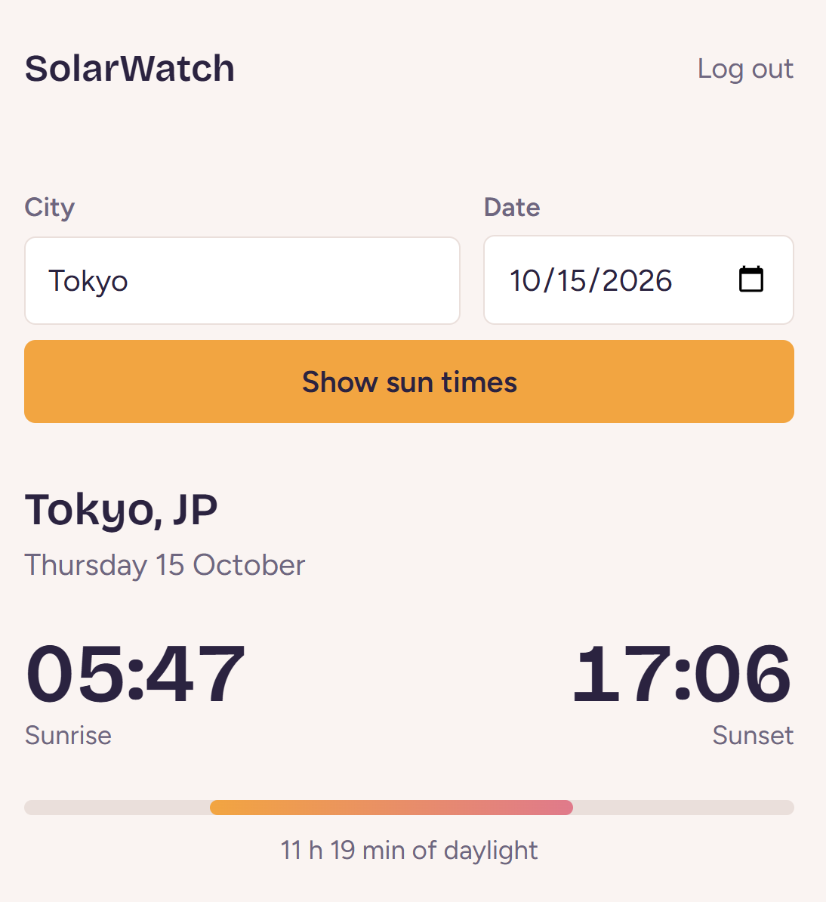
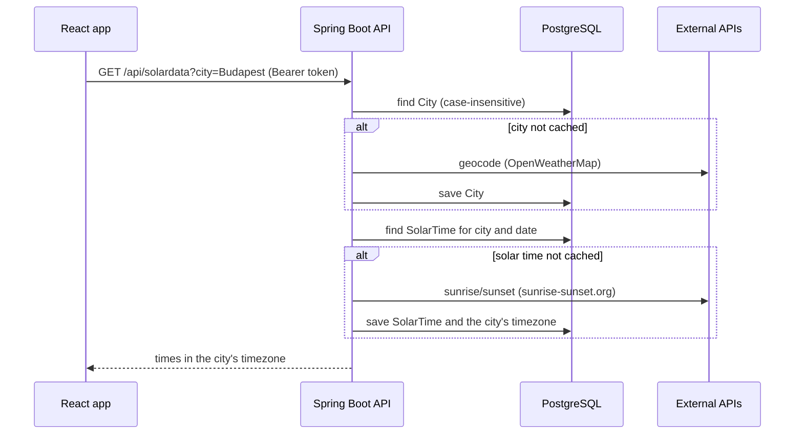
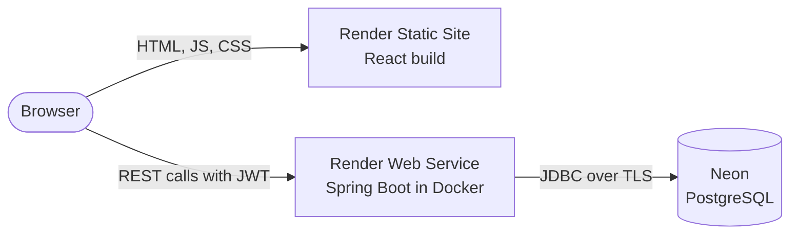

# SolarWatch

[](https://github.com/bucystoni/solar-watch/actions/workflows/maven.yml)


Sunrise and sunset times for any city, on the city's own clock. A Spring Boot API geocodes the city, fetches the times from public APIs and caches both in PostgreSQL. Access uses stateless JWT authentication with user and admin roles.

**[Live demo](https://solar-watch-frontend.onrender.com/)**: register any username to try it. The API sleeps when idle, so the first request can take about a minute.



## Highlights

- **Database as a read-through cache.** PostgreSQL is checked first; the external APIs are called only on a miss. A unique constraint on `(city_id, date)` keeps one row per city per day.
- **Timezone-correct.** Instants and the city's IANA zone (e.g. `Asia/Tokyo`) are stored separately and converted at the edge. "Today" comes from an injected `Clock`, so tests can freeze time.
- **Forgiving city lookup.** Case-insensitive, and alternate spellings (`Budapeszt`) resolve to the same cached city.
- **Stateless JWT security.** A custom `OncePerRequestFilter`, BCrypt passwords, and `USER`/`ADMIN` roles enforced with `@PreAuthorize`. An admin account is seeded on first startup.
- **Clean API boundary.** Endpoints return DTOs, never JPA entities. A `@ControllerAdvice` maps domain exceptions to `404`/`409`.
- **Deterministic tests.** `@SpringBootTest` with MockMvc on H2, with the external clients mocked, so no network, Docker or API key is needed.
- **Containerized, CI-checked, deployed.** A multi-stage Dockerfile, Docker Compose locally, and GitHub Actions on every push. Live on Render and Neon, configured entirely through environment variables.

## Tech stack

| Layer | Technologies |
|---|---|
| Backend | Java 21, Spring Boot 4.1 (Web MVC, Data JPA, Security), JJWT 0.13, WebClient |
| Database | PostgreSQL 16 (H2 for tests) |
| Frontend | React 19, React Router 7, Vite 8 |
| DevOps | Docker, Docker Compose, GitHub Actions, Render, Neon |
| External APIs | [OpenWeatherMap Geocoding](https://openweathermap.org/api/geocoding-api), [sunrise-sunset.org](https://sunrise-sunset.org/api) |

## How it works



## Running locally

Prerequisites: JDK 21, Node.js 22, Docker Desktop, a free [OpenWeatherMap](https://openweathermap.org/api) API key.

**1. Configure.** Copy `backend/.env.example` to `backend/.env` and fill it in:

| Variable | Purpose |
|---|---|
| `POSTGRES_PASSWORD` | Database password |
| `JWT_SECRET` | Base64, at least 32 bytes: `openssl rand -base64 32` (Git Bash) |
| `OPENWEATHER_API_KEY` | OpenWeatherMap key |
| `ADMIN_PASSWORD` | Password for the seeded `admin` user |
| `CORS_ALLOWED_ORIGIN` | Optional; defaults to `http://localhost:5173` |

**2. Start the backend** (API on port 8080, PostgreSQL on 5433):

```bash
cd backend
docker compose up --build      # or: docker compose up -d db, and run the API from your IDE
```

When running the API from IntelliJ, set the variables in the run configuration; Spring doesn't read `.env` files.

**3. Start the frontend** (on port 5173):

```bash
cd frontend
npm install
npm run dev
```

**Tests:** `cd backend` then `./mvnw test` (Windows: `.\mvnw.cmd test`). They also run in CI.

## Deployment



- **Backend:** built from `backend/Dockerfile`. Gets the same variables as above, plus `SPRING_DATASOURCE_URL`/`_USERNAME`/`_PASSWORD` for Neon and `CORS_ALLOWED_ORIGIN` set to the frontend URL. It listens on Render's `PORT` via `server.port=${PORT:8080}`.
- **Frontend:** root `frontend`, build `npm ci && npm run build`, publish `dist`. `VITE_API_URL` is baked in **at build time**, so changing it needs a redeploy. A `/*` → `/index.html` rewrite keeps React Router routes from returning 404 on refresh.
- **Free tier:** the API [spins down after 15 idle minutes](https://render.com/docs/free) and takes about a minute to wake.

## API

All endpoints except `/api/auth/**` need `Authorization: Bearer <token>`. `401` means no or bad token, `403` means wrong role.

| Method | Endpoint | Access | Notes |
|---|---|---|---|
| `POST` | `/api/auth/register` | Public | `201`, or `409` if the username is taken |
| `POST` | `/api/auth/login` | Public | Returns `{ "token": "..." }` |
| `GET` | `/api/solardata?city={name}&date={YYYY-MM-DD}` | User | `date` is optional and defaults to today in the city |
| `GET` | `/api/cities`, `/api/cities/{id}` | User | Cached cities |
| `POST` `PUT` `DELETE` | `/api/cities[/{id}]` | Admin | Manage cities |

## Design notes

- **The database is the cache.** Past and future sunrise times never change, so they're stored permanently, not in memory.
- **Store the zone, not the offset.** An offset like `+09:00` is lost by PostgreSQL and is wrong across DST; a zone like `Asia/Tokyo` carries the rules.
- **Same image everywhere.** Compose and Render run the same container; only environment variables differ. Secrets have no defaults, so a missing one fails at startup.
- **JWT in `localStorage`.** Simple for a separate SPA, but readable by scripts on the page; an `httpOnly` cookie would be safer against XSS.

## Known issues and roadmap

- Same-name cities in different countries share one entry.
- A new city's first lookup without a `date` uses UTC "today".
- External API failures and invalid input return a generic `500`.
- The frontend doesn't log out when the token expires.
- The solar lookup holds a DB transaction during external API calls.
- The day bar doesn't handle polar day or night.
- No versioned migrations (`ddl-auto=update`, planned: Flyway), and SQL/`DEBUG` logging is on in production (planned: a production profile).

## How this was built

Built during the Codecool program. Claude acted as a mentor for code review, debugging and deployment: it explained the concepts, and I wrote the backend fixes, tests and configuration changes. The UI design, CSS and day-bar component were generated with Claude's help and adapted by me; those commits carry a `Co-authored-by: Claude` trailer.

## Author

[@bucystoni](https://github.com/bucystoni), [CodeCool](https://codecool.com) full-stack developer program.
